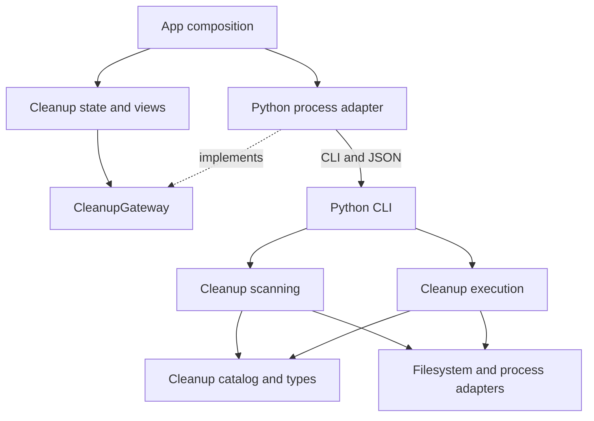

# Headroom

Headroom finds files your Mac can recreate, such as caches, downloaded packages,
Docker images, dependencies, and build artifacts. It estimates how much space each
category could free and deletes only the categories you select.

- **Headroom.app**: a SwiftUI menu bar app with scan progress and a confirmation step.
- **`cleanup.py`**: the command-line interface, using the same engine as the app.

## How it works

The app runs `python3 cleanup.py scan --json --progress` to get a scan report on
stdout and progress events on stderr. After you confirm a selection, it sends
the selected categories as JSON on stdin to `python3 cleanup.py apply`. The
Python engine performs all deletions.

The product is organized around one `Cleanup` feature. Scanning, selection,
confirmation, and execution share the same category catalog and report lifecycle.
The app creates dependencies at startup; the feature receives its engine and
free-space reader so the journey can be tested without running cleanup commands.
Swift remains one executable target; its feature folders group responsibilities
within that module. The Python engine has an explicit package boundary, with
scanning and execution as internal parts of the cleanup feature.



## Project layout

| Path | Purpose |
|---|---|
| `cleanup.py` | Compatible CLI entry point: `scan`, `clean`, and `apply` |
| `headroom_engine/cli/` | Command dispatch, interactive confirmation, and terminal presentation |
| `headroom_engine/features/cleanup/` | Category catalog, cleanup types, JSON contract, scanning, and execution |
| `headroom_engine/platform/` | Operating-system dependencies used by the engine |
| `headroom_engine/i18n.py` | Language selection and localized text |
| `Sources/Headroom/App/` | App entry point and dependency composition |
| `Sources/Headroom/Features/Cleanup/` | Feature state, views, contracts, process adapter, and formatting |
| `Tests/HeadroomTests/`, `Tests/Python/` | Headless behavior and regression tests |
| `Tests/Fixtures/` | Wire-contract examples consumed by both languages |
| `Package.swift`, `Makefile`, `Tools/check-swift.sh` | App build and the combined verification command |
| `build-app.sh`, `Info.plist` | Build and installation script, and app bundle metadata |
| `Tools/make-icon.swift`, `Resources/AppIcon.icns` | Icon generator and app icon |
| `Localization/` | English and Brazilian Portuguese app strings |

## Categories

**Safe to delete** (apps or tools recreate the files; dependencies are unchecked by default in the app):

| Category | Contents |
|---|---|
| App and browser caches | Contents of `~/Library/Caches` |
| Downloaded packages | `~/.npm`, the pnpm store, and the Yarn cache |
| Cursor and Claude caches | Extension and interface caches only |
| Old logs | `~/Library/Logs` |
| Unused Docker images and build cache | `docker image prune -a` and `docker builder prune`; volumes are left alone |
| Worktree dependencies | `node_modules`, `.venv`, `.next`, `.turbo`, and `__pycache__` in agent and Herdr worktrees |
| Project dependencies | The same folders in primary project checkouts |

**Review only** (measured and listed, never deleted): Claude VM image, Docker virtual
disk, unused Docker volumes, Codex history, `~/.local/share`, Cursor state, Herdr
worktrees, MeetingMind and WhatsApp data, Downloads, Movies, and Trash.

## Requirements

- macOS 26 or later for the app's Liquid Glass interface.
- Python 3.10 or later (tested with Python 3.14). The app looks for `python3` in
  `/opt/homebrew/bin` or `/usr/local/bin`.
- The Swift toolchain to build the app. Command Line Tools suffice; full Xcode is not required.
- Docker is optional; Docker entries are omitted when Docker is unavailable.

## Usage

From the repository root:

```sh
rtk proxy python3 cleanup.py              # Show the report without deleting anything
rtk proxy python3 cleanup.py clean        # Ask before cleaning each safe category
rtk proxy python3 cleanup.py clean --yes  # Clean every safe category without asking
```

Use `--lang pt` or `--lang en` to override the shell locale. Command names are the same in both languages.

App integration commands:

```sh
rtk proxy python3 cleanup.py scan --json             # Write the JSON report to stdout
rtk proxy python3 cleanup.py scan --json --progress  # Also write progress events to stderr
rtk proxy python3 cleanup.py apply --lang en         # Read a cleanup plan from stdin and apply it
```

In **Headroom**, click **Scan**, select categories, then choose **Delete selected…**.
The app follows your system language by default. Choose **More options (…) → Language**
to switch between **English** and **Português (Brasil)**. The app remembers your choice.

## Build and install the app

Run this from the repository root:

```sh
rtk proxy ./build-app.sh
```

The script builds and signs the app, then installs it at `~/Applications/Headroom.app`.
The app looks for `cleanup.py` in `~/Developer/Headroom`; if your checkout lives
elsewhere, update `CleanupEngine.locate()` before building.

To regenerate the icon:

```sh
rtk proxy mkdir -p Resources
rtk proxy swiftc Sources/Headroom/BrandArtwork.swift Tools/make-icon.swift -o /tmp/make-icon
rtk proxy /tmp/make-icon Resources
```

## Safety and permissions

- The entire plan is parsed before execution; malformed plans and relative paths
  are rejected at that stage. Each path is checked against the home-folder guard
  before its removal.
- Review-only entries are displayed separately and are not offered for deletion
  by the normal app/CLI flow. In interactive mode, an empty response or closed
  stdin counts as no.
- macOS protects Downloads and Trash. Grant **Full Disk Access** to Headroom
  under **System Settings → Privacy & Security** if those folders show as
  inaccessible. If you use the CLI, grant access to your terminal instead.
- The app is signed ad hoc. macOS may ask for permission again after a rebuild.

## Known limitations

- `du` has no timeout. A stalled folder can block the scan.
- `apply` checks the plan's format but does not restrict which commands it can
  contain. Only use it with trusted input.
- `/tmp` and the user's temporary directory are not scanned.
- Individual cleanup failures are printed and execution continues; a successful
  process exit does not establish that every command or path was cleaned.

## Verification

From the repository root, run the Swift and Python suites with one command:

```sh
rtk proxy make check
```

Tests use named fakes for disk operations and external commands. They do not
scan the home directory, run Docker cleanup, or remove user files. Shared JSON
fixtures cover report decoding, selected-category encoding, and progress events.
Python tests use the standard library; Swift tests use the installed toolchain.
There are no third-party test dependencies or services to configure.

The suite characterizes selection defaults, phase transitions, monotonic
progress, plan validation, command/path ordering, CLI output, and existing
partial-failure behavior. It does not establish visual correctness or macOS
privacy permissions. The Swift checks compile the feature's production sources
with a small native runner: XCTest and Swift Testing are not required, so the
Command Line Tools installation is sufficient. `make check` also builds the app
with Swift Package Manager without installing or launching it.

The CLI and JSON contract remain compatible during this structural migration.
Engine packaging, command authorization, structured cleanup outcomes, and
process timeouts are separate follow-up changes.

## Development

- Keep filenames, identifiers, and comments in English.
- Add category and review text in the engine's cleanup catalog or scanning modules
  as `Localized(pt=..., en=...)`.
- Add SwiftUI text to `Localization/*.lproj/Localizable.strings`. Use the English
  text as the key and provide a Brazilian Portuguese translation in `pt-BR.lproj`.
