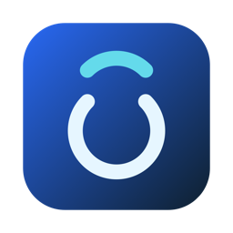
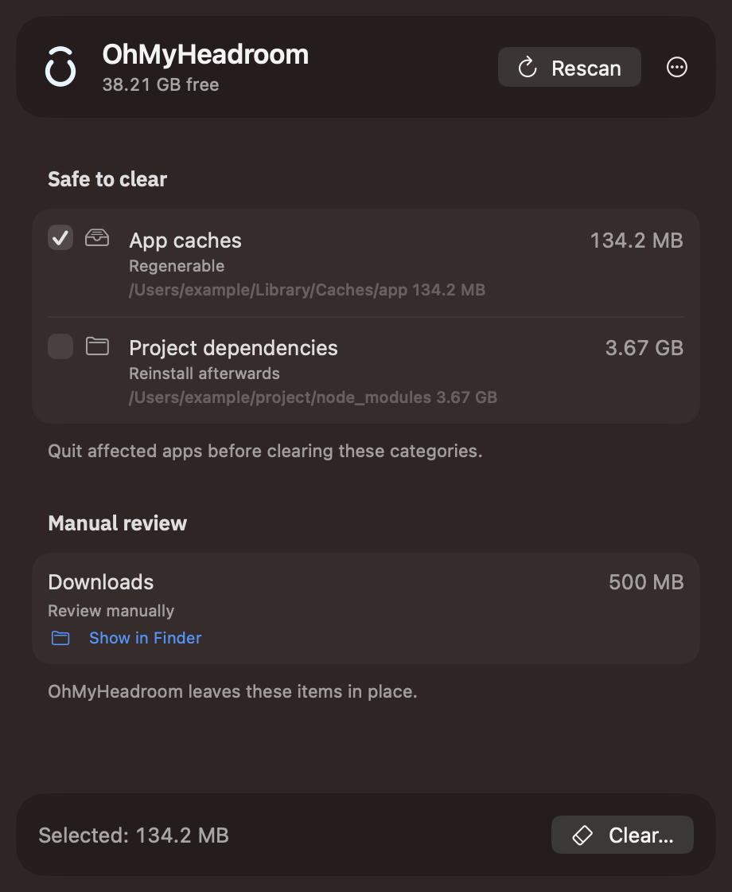
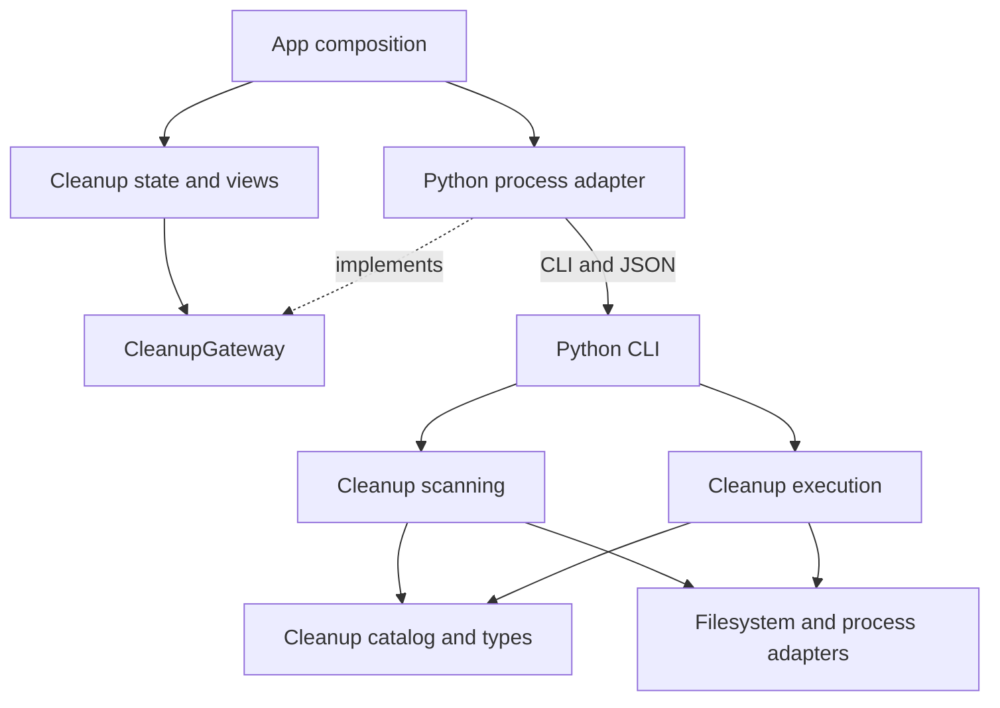

# OhMyHeadroom



OhMyHeadroom finds files your Mac can recreate, such as caches, downloaded packages,
Docker images, dependencies, and build artifacts. It estimates how much space each
category could free and deletes only the categories you select.

- **OhMyHeadroom.app** is a SwiftUI menu bar app with scan progress and a confirmation step.
- **`cleanup.py`**: the command-line interface, using the same engine as the app.



## Install from source

- macOS 26 or later and the Swift toolchain from Xcode Command Line Tools.
- Python 3.10 or later. The menu bar app looks for `python3` in
  `/opt/homebrew/bin` and `/usr/local/bin`.
- Docker is optional. Docker entries are omitted when Docker is unavailable.

```sh
git clone https://github.com/naeliofreires/OhMyHeadroom.git
cd OhMyHeadroom
./build-app.sh
```

The script builds and signs a local copy of the app and bundles the Python engine.
You can move or remove the checkout after installation. If you previously installed
Headroom, quit it and move `~/Applications/Headroom.app` to the Trash before opening
the new app. Your language and theme preferences carry over.

```sh
open "$HOME/Applications/OhMyHeadroom.app"
```

When OhMyHeadroom appears in the menu bar, click **Scan** to see what it found.
Select the categories you want to clear, then click **Clear…** and confirm.
The panel shows progress while the engine clears the selection and measures what
remains. The result compares the selected size from the scan with the remaining
size and shows the execution log.

The CLI uses the same engine. From the repository root, `python3 cleanup.py scan`
shows a report without deleting anything.

OhMyHeadroom supports English and Brazilian Portuguese. The app follows the system
language by default. Use **More options (…) → Language** to change it, or pass
`--lang pt` or `--lang en` to the CLI.

Use **More options (…) → Theme** to choose **Light**, **Dark**, or **System**.
OhMyHeadroom follows the macOS appearance by default and remembers your selection.

## How it works

The app runs `python3 cleanup.py scan --json --progress` to get a scan report on
stdout and progress events on stderr. After you confirm a selection, it sends
the selected categories as JSON on stdin to `python3 cleanup.py apply --json`.
The Python engine performs all deletions and returns the selected sizes before
and after cleanup, along with the execution log. If the remaining size cannot be
measured, the result reports it as unavailable.

The product is organized around one `Cleanup` feature. Scanning, selection,
confirmation, and execution share the same category catalog and report lifecycle.
The app creates dependencies at startup; the feature receives its engine and
free-space reader so the journey can be tested without running cleanup commands.
Swift remains one executable target; its feature folders group responsibilities
within that module. The Python engine has an explicit package boundary, with
scanning and execution as internal parts of the cleanup feature.



## Project layout

| Path | Purpose |
|---|---|
| `cleanup.py` | Compatible CLI entry point: `scan`, `clean`, and `apply` |
| `ohmyheadroom_engine/cli/` | Command dispatch, interactive confirmation, and terminal presentation |
| `ohmyheadroom_engine/features/cleanup/` | Category catalog, cleanup types, JSON contract, scanning, and execution |
| `ohmyheadroom_engine/platform/` | Operating-system dependencies used by the engine |
| `ohmyheadroom_engine/i18n.py` | Language selection and localized text |
| `Sources/OhMyHeadroom/App/` | App entry point and dependency composition |
| `Sources/OhMyHeadroom/Features/Cleanup/` | Feature state, views, contracts, process adapter, and formatting |
| `Tests/OhMyHeadroomTests/`, `Tests/Python/` | Headless behavior and regression tests |
| `Tests/Fixtures/` | Wire-contract examples consumed by both languages |
| `Package.swift`, `Makefile`, `Tools/check-swift.sh` | App build and the combined verification command |
| `build-app.sh`, `Info.plist` | Build and installation script, and app bundle metadata |
| `Tools/make-icon.swift`, `Resources/AppIcon.icns` | Icon generator and app icon |
| `Localization/` | English and Brazilian Portuguese app strings |

## Categories

**Safe to clear** (apps or tools recreate the files; dependencies are unchecked by default in the app):

| Category | Contents |
|---|---|
| App and browser caches | Contents of `~/Library/Caches` |
| Downloaded packages | `~/.npm`, the pnpm store, and the Yarn cache |
| Cursor and Claude caches | Extension and interface caches only |
| Old logs | `~/Library/Logs` |
| Unused Docker images and build cache | `docker image prune -a` and `docker builder prune`; volumes are left alone |
| Worktree dependencies | `node_modules`, `.venv`, `.next`, `.turbo`, and `__pycache__` in agent and Herdr worktrees |
| Project dependencies | The same folders in primary project checkouts |

OhMyHeadroom looks for project dependencies under `~/Developer`, `~/.herdr`, `~/.t3`,
and `~/.synara`. Docker commands use the active Docker context.

**Review only** (measured and listed, never deleted): Claude VM image, Docker virtual
disk, unused Docker volumes, Codex history, `~/.local/share`, Cursor state, Herdr
worktrees, MeetingMind and WhatsApp data, Downloads, Movies, and Trash.

## Command-line usage

```sh
python3 cleanup.py --help           # Show command-line usage
python3 cleanup.py scan              # Show the report without deleting anything
python3 cleanup.py clean             # Ask before cleaning each category
python3 cleanup.py scan --json      # Write the JSON report to stdout
```

The app uses `scan --json --progress` for progress events and `apply --json` to
execute a confirmed plan and return the comparison. `apply` reads a plan from
standard input and runs its commands with your permissions. Use it only with
trusted input.

## Safety and permissions

- The entire plan is parsed before execution; malformed plans and relative paths
  are rejected at that stage. Each path is checked against the home-folder guard
  before its removal.
- Review-only entries are displayed separately and are not offered for deletion
  by the normal app/CLI flow. In interactive mode, an empty response or closed
  stdin counts as no.
- macOS protects Downloads and Trash. Grant **Full Disk Access** to OhMyHeadroom
  under **System Settings → Privacy & Security** if those folders show as
  inaccessible. If you use the CLI, grant access to your terminal instead.
- The app is signed ad hoc. macOS may ask for permission again after a rebuild.

## Known limitations

- `du` has no timeout. A stalled folder can block the scan.
- Project dependency scans are limited to the directories listed above.
- `/tmp` and the user's temporary directory are not scanned.
- Individual cleanup failures are printed and execution continues; a successful
  process exit does not establish that every command or path was cleaned.

## Verification

From the repository root, run the Swift and Python suites with one command:

```sh
make check
```

Tests use named fakes for disk operations and external commands. They do not
scan the home directory, run Docker cleanup, or remove user files. Shared JSON
fixtures cover report decoding, selected-category encoding, cleanup results, and
progress events.
Python tests use the standard library; Swift tests use the installed toolchain.
There are no third-party test dependencies or services to configure.

The suite characterizes selection defaults, phase transitions, monotonic
progress, plan validation, command/path ordering, CLI output, and existing
partial-failure behavior. It does not establish visual correctness or macOS
privacy permissions. The Swift checks compile the feature's production sources
with a small native runner: XCTest and Swift Testing are not required, so the
Command Line Tools installation is sufficient. `make check` also builds the app
with Swift Package Manager without installing or launching it.

## Development

- Keep filenames, identifiers, and comments in English.
- Add category and review text in the engine's cleanup catalog or scanning modules
  as `Localized(pt=..., en=...)`.
- Add SwiftUI text to `Localization/*.lproj/Localizable.strings`. Use the English
  text as the key and provide a Brazilian Portuguese translation in `pt-BR.lproj`.

To regenerate the icon:

```sh
swiftc Sources/OhMyHeadroom/BrandArtwork.swift Tools/make-icon.swift -o /tmp/ohmyheadroom-make-icon
/tmp/ohmyheadroom-make-icon Resources
```

## License

OhMyHeadroom is released under the [MIT License](LICENSE).
The bundled IBM Plex Sans font is distributed under the [SIL Open Font License](Sources/OhMyHeadroom/Fonts/LICENSE.txt).
